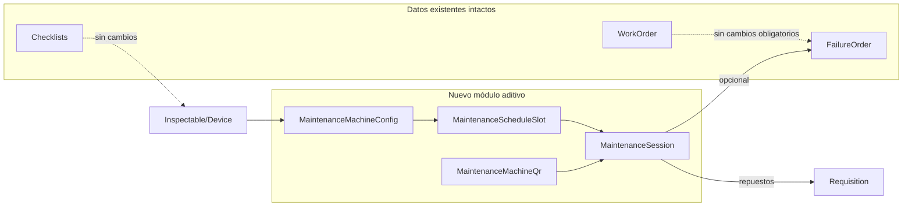
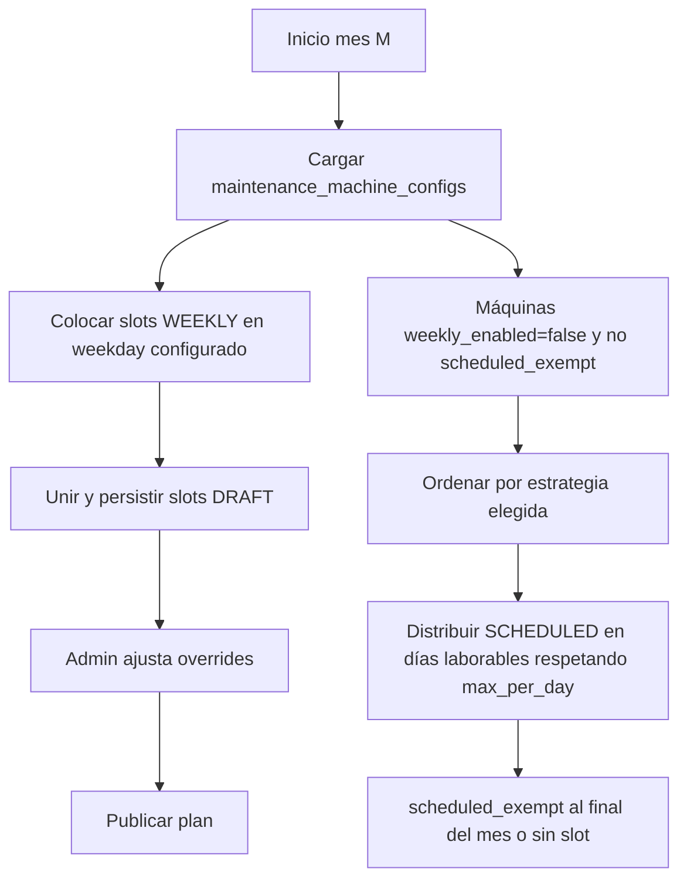
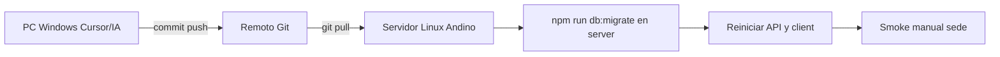

# Plan: Cronograma flexible de mantenimiento (Andino)

## Contexto del sistema actual (lo que ya tienes)

| Dominio | Estado en código | Relevancia |
|---------|------------------|------------|
| **Máquinas** | [`Inspectable`](server/src/models/inspectable.js) + [`Device`](server/src/models/device.js) (STI `type_code: device`) | Universo de equipos del calendario |
| **Checklists semanales** | Familias en [`ChecklistType`](server/src/models/checklist_type.js) (`frequency: semanal`, `week_identifier` en [`checklists`](server/src/migrations/20260429000000-add-week-identifier-to-checklists.js)) | **No se reutilizan** para este flujo (decisión: flujo nuevo) |
| **QR** | [`ChecklistQrCode`](server/src/models/checklistQrCode.js) atado a `checklist_type_id` y solo categoría `attraction` en [`qrCodeController`](server/src/controllers/qrCodeController.js) | Patrón a copiar; **QR de mantenimiento será tabla/rutas nuevas** por `ins_id` |
| **Fallas / correctivos** | [`FailureOrder`](server/src/models/FailureOrder.js) (`affected_id` → máquina), cierre vía [`RepairExecution`](server/src/models/repairExecution.js) / [`WorkOrder`](server/src/models/workOrder.js) | Priorización por fallas activas; cierre el mismo día desde la vista del calendario |
| **Inventario / requisiciones** | [`Requisition`](server/src/models/requisition.js) (`work_order_id`, `checklist_id`) | Extender con FK **opcional** a sesión de mantenimiento |
| **Exportes** | Excel: [`FailureBookExportService`](server/src/services/FailureBookExportService.js); PDF: Puppeteer en [`checklistController`](server/src/controllers/checklistController.js) | Informe mensual + PDF por sesión completada |
| **UI de referencia** | Feature [`failure-book`](client/src/features/failure-book/FailureBookPage.jsx) (hooks, filtros, export) | Misma estructura: `client/src/features/maintenance-scheduler/` |

---

## Reglas de negocio acordadas

1. **Clasificación de máquinas (admin)**  
   - Por cada dispositivo (`inspectables` + `devices`): el admin activa **preventivo semanal** (`weekly_enabled`).  
   - Las máquinas **sin** marca semanal entran al pool de **preventivo programado** (ciclo mensual/ configurable).  
   - Opcional en configuración: **“sin preventivo programado”** (`scheduled_exempt`) → solo correctivos; en ordenamiento van **al final del ciclo** (como pediste).

2. **Tipos de actividad en un día**  
   - Una misma fecha puede tener **varias casillas**: semanal de máquina A + programado de máquina B (+ correctivos ad hoc).  
   - El técnico ejecuta cada ítem desde el calenadrio o escaneando QR de la máquina (lista de pendientes del día para ese `ins_id`).

3. **Semanal (flujo nuevo)**  
   - QR válido → inicia sesión → **4 fotos obligatorias** (`INICIO`, `PROCESO_1`, `PROCESO_2`, `FIN`) + descripción.  
   - Inventario consumido y requisiciones desde la misma pantalla (reutilizar componentes: [`WorkOrderPartsManager`](client/src/components/checklist/WorkOrderPartsManager.jsx), modales de inventario/requisición).

4. **Programado (preventivo programado — PP)**  
   - **QR obligatorio** igual que el semanal: no se puede iniciar ni completar sesión `SCHEDULED` sin escaneo válido del QR de la máquina (`maintenance_machine_qr_codes`).  
   - Misma UX: 4 fotos obligatorias + descripción (+ inventario/requisiciones en fase 3).  
   - Plantilla de tareas **configurable por admin** (fase 2 opcional; MVP: 4 fotos + descripción).

5. **QR obligatorio en ambos preventivos**  
   - `POST .../sessions/start` exige `qr_code` + coincidencia `ins_id` del slot; abrir solo desde calendario sin QR queda deshabilitado.  
   - Auditoría en `maintenance_qr_scans` al iniciar sesión.

6. **Estados visuales — dos niveles**  

   **A) Casilla por slot (máquina + tipo + fecha)**  

   | Color | Condición |
   |-------|-----------|
   | **Rojo** | Sin sesión o sin avance en tareas planificadas de ese slot (día vencido o sin actividad) |
   | **Amarillo** | Sesión iniciada o incompleta (faltan evidencias / no “completar”) |
   | **Azul** | Sesión del slot completada al 100% (QR + 4 fotos + descripción + completar) |

   **B) Celda agregada del día (por técnico)** — bonificación de productividad  

   | Color | Condición |
   |-------|-----------|
   | **Rojo** | Ningún preventivo planificado del día completado |
   | **Amarillo** | Al menos uno iniciado o parcial; no todos los preventivos del día en azul |
   | **Azul** | **Todos** los preventivos planificados ese día cumplidos: cada slot **semanal** que tocaba ese día **+** cada slot **PP** que tocaba ese día (si a una máquina solo le toca semanal, no exige PP; si solo PP, no exige semanal) |
   | **Verde** | Condición **azul** **+** al menos una falla cerrada (AR/OT resuelta) el mismo día en una **máquina distinta**: `failure_orders.affected_id` **≠** cualquier `ins_id` con slot preventivo (WEEKLY o SCHEDULED) planificado ese día para ese técnico. Cerrar fallas de la misma máquina del cronograma **no** sube a verde (es lo esperado en esa visita). |

   Cálculo en backend (`slot_display_status`, `day_display_status`) para calendario y reportes. Tabla `maintenance_day_failure_closures` registra cierres del **día/técnico**; solo cuentan para verde si `affected_ins_id` no está en el conjunto de máquinas con preventivo planificado ese día.

7. **Priorización del calendario (admin elige estrategia por sede/mes)**  
   - **Por último preventivo programado** (`last_scheduled_at` en config o última sesión `SCHEDULED` completada).  
   - **Por fallas acumuladas** (conteo de `FailureOrder` activas por `affected_id`, rol técnico).  
   - **Híbrido (recomendado default)**: score = `failure_count * peso + days_since_last_scheduled * peso`; exentas al final.  
   - **Capacidad**: N programados por día laborable (config); semanales anclados al **día de la semana** configurado por máquina o global.

8. **Replanificación**  
   - Admin puede **arrastrar/swap** slots de meses futuros; cambios guardados como `is_manual_override = true` para no sobrescribir en regeneración automática.

---

## Modelo de datos (solo migraciones `up`, tablas nuevas)

Archivo sugerido: prefijo `20261010000000-*` en [`server/src/migrations/`](server/src/migrations/).

| Tabla | Propósito |
|-------|-----------|
| `maintenance_settings` | `premise_id`, estrategia, `max_scheduled_per_day`, días laborables, pesos híbrido |
| `maintenance_machine_configs` | `ins_id` (unique), `weekly_enabled`, `weekly_weekday`, `scheduled_exempt`, `last_scheduled_at` (nullable, carga inicial manual), `is_active` |
| `maintenance_schedule_plans` | `year_month` (2026-10), `status` DRAFT/PUBLISHED, `generated_at`, `published_by` |
| `maintenance_schedule_slots` | `plan_id`, `scheduled_date`, `ins_id`, `slot_type` WEEKLY/SCHEDULED, `sort_priority`, `is_manual_override`, `assigned_user_id` nullable |
| `maintenance_sessions` | `slot_id`, `ins_id`, `type`, `status` DRAFT/COMPLETED, `technician_id`, `description`, `started_at`, `completed_at`, `duration_minutes` |
| `maintenance_session_evidences` | `session_id`, `phase` enum 4 fases, `file_url` |
| `maintenance_session_parts` | `session_id`, `inventory_id`, `quantity` (consumo directo) |
| `maintenance_day_failure_closures` | `closure_date`, `technician_id`, `failure_order_id`, `affected_ins_id` (para bonificación verde: distinto de `ins_id` con slot ese día) |
| `maintenance_machine_qr_codes` | `ins_id`, `qr_code` unique, `is_active`, `created_by` |
| `maintenance_qr_scans` | auditoría de escaneos (opcional fase 1) |

**Alteración mínima existente (segura):**  
- `requisitions.maintenance_session_id` NULLable + índice. **No** modificar columnas NOT NULL actuales.

**No usar** [`maintenance_actions`](server/src/models/maintenance_action.js) (tabla huérfana ligada solo a `work_orders`); evita confusión semántica.

---

## Backend: capas y rutas

Nuevo namespace **`/api/maintenance-scheduler`** en [`server/src/index.js`](server/src/index.js):

| Área | Servicio | Endpoints clave |
|------|----------|-----------------|
| Config admin | `MaintenanceConfigService` | CRUD configs por máquina; bulk import CSV; estrategia sede |
| Planificación | `MaintenanceScheduleService` | `POST .../plans/generate?month=`, `PATCH .../slots/:id`, `POST .../plans/:id/publish` |
| Ejecución | `MaintenanceSessionService` | `POST .../sessions/start` (**slot_id + qr_code** obligatorios), upload evidencias (multer existente [`localStorageConfig`](server/src/config/multerConfig.js)), `POST .../sessions/:id/complete` |
| QR | `MaintenanceQrService` | generate/list/validate por `ins_id` (espejo de lógica QR, sin checklist_type) |
| Reportes | `MaintenanceReportService` | `GET .../reports/monthly?month=` (Excel); `GET .../sessions/:id/pdf` (Puppeteer) |
| Integración fallas | reutilizar `repairExecutionService` / `workOrderService` | `POST .../days/:date/link-failure-closure` (vincula cierre al día del técnico; valida máquina distinta para verde) |

**Autorización:**  
- Admin (1) y Soporte (2): config, plan, reportes.  
- Técnico (3, 7): calendario operativo, sesiones, cierre fallas en contexto de día/máquina.

**Regeneración de plan:**  
- Solo meses **DRAFT** o futuros no publicados; slots con `is_manual_override` se preservan al regenerar.

---

## Frontend

Estructura espejo de failure-book:

- [`client/src/features/maintenance-scheduler/`](client/src/features/maintenance-scheduler/)  
  - `MaintenanceSchedulerPage.jsx` — calendario mensual (grid: días × chips por máquina/tipo).  
  - `MaintenanceConfigPanel.jsx` — tabla de dispositivos: toggle semanal, día semana, exento programado, última fecha programada.  
  - `MaintenanceDayDrawer.jsx` — detalle del día: abrir sesión, ver colores, cerrar fallas.  
  - `MaintenanceSessionWizard.jsx` — QR → evidencias → descripción → partes/requisiciones → completar → descargar PDF.  
  - `hooks/useMaintenanceCalendar.js`, `useMaintenanceSession.js`  
  - `utils/maintenanceSchedulerApi.js`

**Rutas Next.js:**  
- `/mantenimiento/cronograma` — técnicos + admin (vista operativa).  
- `/AdminDashboard` — nueva pestaña “Cronograma mantenimiento” (solo config/planes/publicar), o subruta `/mantenimiento/admin`.  
- Enlace en [`dashboard.js`](client/src/components/dashboard/dashboard.js) quick actions.

**Componentes reutilizados (sin romper checklists):**  
- Escaneo QR: adaptar flujo de [`QrUnlockBar`](client/src/components/checklist/QrUnlockBar.jsx) / validación API nueva.  
- Fallas: [`FailureDetailModal`](client/src/components/checklist/FailureDetailModal.jsx) filtrado por `affected_id` + fecha.  
- Partes: `WorkOrderPartsManager` + APIs inventario existentes.

---

## Algoritmo de generación (resumen)

**Datos históricos para prioridad:** consulta agregada sobre `failure_orders` + `repair_executions`/`work_orders` (misma lógica de estado efectivo que [`FailureBookService`](server/src/services/FailureBookService.js)). **No** backfill automático sobre checklists antiguos.

---

## Informe mensual de productividad

Hojas Excel (patrón FailureBook):

1. **Resumen** — % días verde/azul/amarillo/rojo por técnico; promedio y mediana de `duration_minutes` por tipo de sesión.  
2. **Por técnico** — sesiones completadas, días verde (bonificación), fallas cerradas en otra máquina, tiempo total.  
3. **Por máquina** — último programado, fallas activas al cierre de mes, cumplimiento semanal.  
4. **Detalle de trabajos** — solo **texto**: descripción de sesiones preventivas, descripción/actividad de fallas cerradas ese día, técnico, máquina, duración. **Sin** PDF embebido, **sin** imágenes ni enlaces a binarios pesados; opcional columna `session_id` / URL de plataforma para abrir el detalle con fotos y PDF en la app.

Métricas de “cuánto tardan”: `completed_at - started_at` (y opcional timestamps por fase de evidencia en fase 2).

---

## Flujo de trabajo: Windows (desarrollo) → Linux Andino (BD real)

Trabajo **por fases del plan** con IA en tu PC Windows; validación integrada **solo en el servidor Linux** donde ya corre la app y MySQL/Postgres de sede.

### Reglas para cada fase (humano + IA)

1. **Una fase = un bloque de entrega** alineado con [Fases de implementación](#fases-de-implementación-recomendadas) (no mezclar Fase 3 en el mismo push que Fase 1 salvo hotfix).  
2. **Rama sugerida:** `feature/maintenance-scheduler-phase-1` (… `-phase-2`, etc.) o commits etiquetados `maint-scheduler: phase-1 …` en `main` si ya trabajas directo ahí.  
3. **En Windows:** implementar, lint/build local si aplica (`client` build opcional; backend `node` sin BD real está bien). **No** ejecutar `db:reset` ni migraciones contra la BD de Andino desde Windows unless tengas `.env` apuntando a un clon de prueba.  
4. **En Linux (checklist post-`git pull`):**
   - `git pull` en la ruta del proyecto desplegado.  
   - `npm install` en `server/` (y `client/` si cambió dependencias).  
   - **Solo en servidor:** `cd server && npm run db:migrate` ([script existente](server/package.json)).  
   - Rebuild client de producción si tu despliegue lo exige (`npm run build` en `client/`).  
   - Reiniciar procesos (PM2/systemd/docker — el que uses hoy).  
   - Verificar `.env` en Linux: añadir `MAINTENANCE_SCHEDULER_ENABLED=true` cuando quieras mostrar el módulo (Fase 1 puede ir en `false` hasta migrar).  
5. **Prohibido en servidor real:** `npm run db:reset`, `db:migrate:undo:all`, seeders masivos no revisados. Rollback de una fase = `db:migrate:undo` **solo** la última migración del módulo, tras backup.  
6. **Archivos sensibles:** `.env`, `uploads/`, credenciales — no van en Git; en Linux deben seguir existiendo rutas de media (`/uploads`, Puppeteer en **Linux**, no en Windows dev).  
7. **Definition of done por fase:** código en remoto + migraciones aplicadas en Linux + smoke de regresión (abajo) + nota breve en commit de qué probar en UI.

### Smoke test mínimo tras cada pull en Linux

| Siempre | Si la fase tocó cronograma |
|---------|----------------------------|
| Login técnico y admin | Ruta `/mantenimiento/cronograma` (flag ON) |
| Abrir libro de fallas, listar una página | Config admin máquinas semanal vs PP |
| Abrir un checklist existente (familia o atracción) | Generar/publicar plan mes de prueba |
| Crear o ver una OF sin error 500 | QR + sesión de prueba en una máquina |

### Cómo pedirle a la IA que avance

Al iniciar cada sesión de implementación, indicar explícitamente: *“Implementa solo la Fase N del plan cronograma_mantenimiento; no adelantes fases; deja lista la lista de comandos post-pull para Linux.”*  
Al cerrar la fase, la IA debe entregar: archivos tocados, migraciones nuevas, variables `.env` opcionales, y pasos exactos para el servidor.

---

## Estrategia de despliegue sin pérdida de datos

1. **Migraciones solo `createTable` / `addColumn` nullable** — ejecutar **en Linux Andino** tras cada pull que incluya archivos en `server/src/migrations/`; rollback = `down` elimina tablas nuevas, no toca legacy.  
2. **Feature flag** `MAINTENANCE_SCHEDULER_ENABLED` (env en **servidor Linux**) — UI oculta hasta config inicial.  
3. **Carga inicial:** admin marca semanales y opcionalmente `last_scheduled_at` por máquina (no obligatorio; si null, algoritmo trata como “muy atrasado”).  
4. **Convivencia:** checklists familiares/atracción siguen igual; cero migración de respuestas antiguas al nuevo módulo.  
5. **Pruebas de regresión:** smoke de `/fallas`, checklist semanal una familia, crear/cerrar OF existente, export libro de fallas (tabla anterior).  
6. **Backup BD** en Linux antes del primer `db:migrate` del módulo (dump MySQL/pg según tu stack).

---

## Fases de implementación recomendadas

### Fase 1 — Fundación (MVP operativo)
- Migraciones + modelos Sequelize + API config máquinas (semanal vs programado).  
- Generador de plan mensual + calendario UI + colores.  
- Sesión semanal y PP con QR obligatorio, 4 fotos, completar → slot azul; día agregado azul/amarillo/rojo.  
- Publicar plan.

### Fase 2 — Correctivos el mismo día
- Vincular cierres de falla al día del técnico → día **verde** solo si la falla es de **otra** máquina (≠ `ins_id` del cronograma ese día).  
- Drawer: fallas activas por máquina + registro de cierre vinculado al día.

### Fase 3 — PDF + requisiciones
- PDF sesión (Puppeteer).  
- `maintenance_session_id` en requisiciones + flujo solicitud desde sesión.

### Fase 4 — Informe mensual + pulido admin
- Excel mensual productividad.  
- Drag-and-drop replanificación, regenerar mes futuro preservando overrides.

---

## Riesgos y mitigaciones

| Riesgo | Mitigación |
|--------|------------|
| Confundir QR checklist vs QR mantenimiento | QR en tabla separada; UI “Mantenimiento” explícita; PDF impreso distinto |
| Sobrecarga de un día (muchas máquinas) | `max_scheduled_per_day` + aviso admin al publicar |
| Técnicos duplican trabajo (checklist familia + nuevo semanal) | Comunicación operativa; futuro: flag “legacy checklist opcional” por familia (fuera de MVP) |
| Puppeteer solo probado en Linux Andino | Desarrollo en Windows; probar PDF en servidor real; fallback Excel si falla headless |
| Desfase Windows/Linux (dependencias, paths) | Tras pull, `npm install` en server/client; no asumir que migrate corre en Windows |
| Pull de fase a medias | Una fase por push; migraciones forward-only en producción |

---

## Criterios de aceptación (MVP)

- Admin marca ≥1 máquina semanal y el resto recibe slots programados en un mes publicado.  
- Técnico completa semanal o PP con QR + 4 fotos → slot **azul**.  
- Todos los preventivos del día completos → día **azul**; sesión parcial → **amarillo**; sin cumplimiento → **rojo**.  
- Fase 2: cierre de falla en **otra** máquina el mismo día → día **verde**.  
- Libro de fallas y checklists existentes sin cambios de comportamiento.  
- Informe mensual descargable (Fase 4) con tiempos y productividad por técnico.
